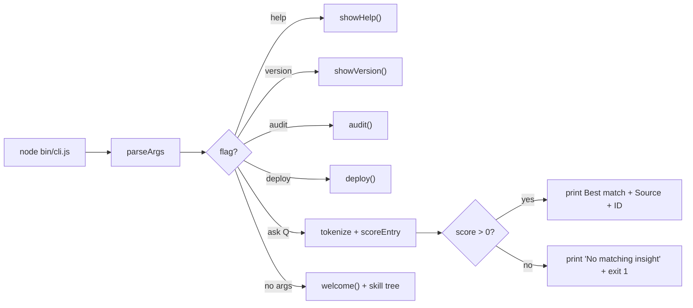

# mrodgersjs-web

[](https://github.com/mrodgersjs-web/mrodgersjs-web-teammate/actions/workflows/ci.yml)
[](LICENSE)
[](.github/workflows/ci.yml)

Install Mike Rodgers as a local Forward Deployed Engineer teammate. A
zero-dependency Node CLI that ships a bundled knowledge base of real
projects and answers questions about gates, proof, autonomy, and
deployment.

## Quickstart

```bash
git clone https://github.com/mrodgersjs-web/mrodgersjs-web-teammate.git
cd mrodgersjs-web-teammate
node bin/cli.js                # interactive welcome + skill tree
node bin/cli.js --version      # 0.2.0
node bin/cli.js --ask "gate-d" # Best match: Gate-D: ...
```

Zero dependencies, no `npm install` needed; the CLI runs straight from
the clone on Node 18+.

## Usage

```bash
node bin/cli.js                       # welcome + skill tree (default)
node bin/cli.js --version             # 0.2.0
node bin/cli.js --help                # lists every flag
node bin/cli.js --audit               # prints the six operating principles
node bin/cli.js --deploy              # prints the flagship clone command
node bin/cli.js --ask "<question>"    # searches data/knowledge.json
```

The `--ask` query runs entirely locally against the bundled
`data/knowledge.json` (18 entries across gates, proof, autonomy,
deployment, and principles). Output is always in this shape:

```
Best match: <title> (<category>)

<entry text>

Source: <repo> · ID: <id>
```

A query with no hit exits 1 and prints:

```
No matching insight found in the knowledge base.
Try asking about gates, proof, deployment, autonomy, or principles.
```

## Why this exists

A static resume is a document, not a teammate. `mrodgersjs-web` ships
the same gate discipline, proof-first verification, and operating
principles that sit behind every shipped repo, in a single binary you
can `git clone` and run on a plane. The CLI is rule-based, so two
runs of the same question produce the same output and every answer is
traceable back to a numbered entry in a checked-in JSON file.

## How it works



## Real output (run from this working tree)

```
$ node bin/cli.js --version
0.2.0

$ node bin/cli.js --ask "gate-d"
Best match: Gate-D: Outward Action Requires Explicit Human Approval (gates)

No deploy, publish, payment, send, or destructive command runs without a typed human approval. Gate-D is fail-closed: an honest SKIP is never a fake PASS, and approval in one context does not extend to the next.

Source: proof-studio · ID: gate-001
```

## What it proves

| What | Command |
| --- | --- |
| CLI surface | `node --test test/cli.test.js` |
| Search scoring | `node --test test/tokenize.test.js` |
| Help and banner | `node --test test/help.test.js` |
| Lint | `npm run lint` |
| End-to-end (install + lint + test) | `npm run check` |
| CI matrix Node 18 / 20 / 22 | `.github/workflows/ci.yml` |

## Project layout

```text
bin/cli.js
data/knowledge.json      18 entries, 5 categories
test/cli.test.js          5 surface tests
test/tokenize.test.js     4 scoring tests
test/help.test.js         3 help / banner tests
eslint.config.mjs         ESLint v9 flat config
docs/architecture.md      flow + scoring contract
.github/                  ci.yml, dependabot.yml, ISSUE_TEMPLATE/, PULL_REQUEST_TEMPLATE.md
CHANGELOG.md
CODE_OF_CONDUCT.md
CONTRIBUTING.md
SECURITY.md
LICENSE
CITATION.cff
package.json
```

## Development

```bash
npm install
npm test
npm run check
```

## Contributing

See [CONTRIBUTING.md](CONTRIBUTING.md). Public-boundary safe.

## Security

See [SECURITY.md](SECURITY.md). Report exploitable bugs to
**security@rodgersintelligence.com**, no public issue.

## License

[MIT](LICENSE).

---

Built by Mike Rodgers · rodgersintelligence.com
