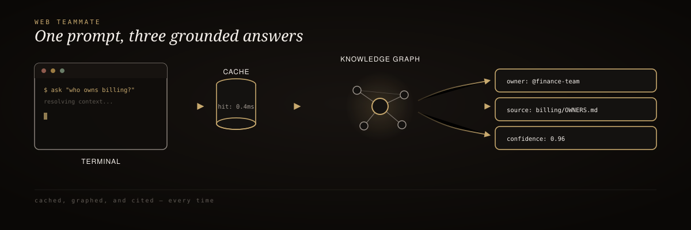

<div align="center">
  
</div>

<br/>

<div align="center">
  <h3>mrodgersjs-web</h3>
  <p><em>Install a Forward Deployed Engineer as a local teammate.</em></p>
</div>

<div align="center">

[](https://www.npmjs.com/package/mrodgersjs-web)


[](LICENSE)

</div>

<br/>

> 🥇 A career, packaged as an installable artifact. Instead of a static resume, `npx mrodgersjs-web` brings gate discipline, proof-first verification, and the operating principles behind every shipped repo into your terminal.

## 60-second install

```bash
npx mrodgersjs-web
```

No global install required — `npx` downloads the package and runs it once.

```bash
# Interactive welcome + skill tree
npx mrodgersjs-web

# Ask Mike a question about gates, proof, autonomy, or deployment
npx mrodgersjs-web --ask "how do I verify a build?"

# Print the six operating principles
npx mrodgersjs-web --audit

# Print the flagship clone command
npx mrodgersjs-web --deploy
```

## How it works

<div align="center">
  
</div>

<sub align="center">npx install → bundled knowledge base (proof-studio, rigforge, jake-studio) → --ask / --audit / --deploy</sub>

## Knowledge base

`data/knowledge.json` ships 15–20 entries across five categories:

| Category | Covers |
| :-- | :-- |
| `gates` | Gate-D, approval flows, fail-closed behavior |
| `proof` | ProofPacket format, signature checks, false-done detection |
| `autonomy` | Earned autonomy, operator-owned decisions, kill criteria |
| `deployment` | Flagship clone workflow, verify-before-ship |
| `principles` | The six operating principles |

## Why it exists

- **A teammate, not a document** — answers questions from a bundled knowledge base of real, shipped projects
- **Surfaces gate discipline before any outward action** — no answer skips the approval boundary
- **Refuses fake-done claims** — proof-first verification is the default posture, not a setting
- **Zero runtime dependencies** — works anywhere Node 18+ runs

## Documentation

| Resource | Description |
| :-- | :-- |
| [proof-studio](https://github.com/mrodgersjs-web/proof-studio) | Signed ProofPackets referenced in the knowledge base |
| [rigforge](https://github.com/mrodgersjs-web/rigforge) | Package-first build platform referenced in the knowledge base |
| [jake-studio](https://github.com/mrodgersjs-web/jake-studio) | Operator closed loops referenced in the knowledge base |
| [LICENSE](LICENSE) | MIT |

---

<div align="center"><sub>Built by Mike Rodgers · Forward Deployed Engineer · <a href="https://rodgersintelligence.com">rodgersintelligence.com</a></sub></div>
