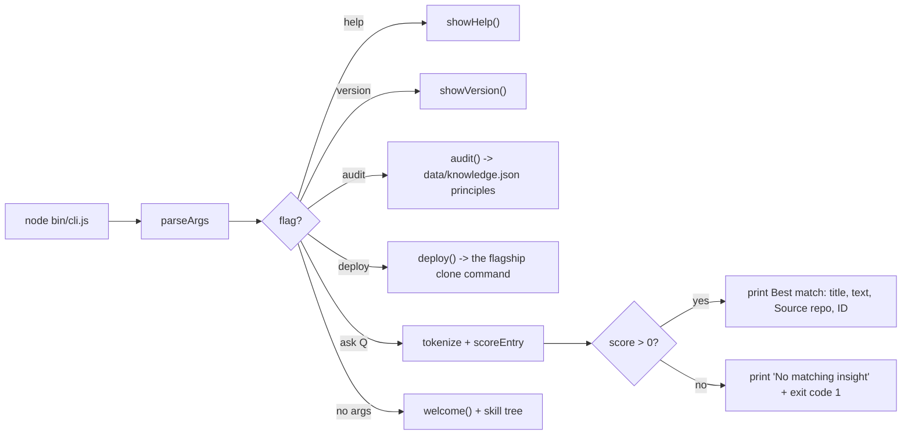

# Architecture — mrodgersjs-web

## One-liner
A zero-dependency Node CLI that ships a bundled knowledge base and
answers questions about gates, proof, autonomy, and deployment.

## Flow

## Why a knowledge base, not a model call

The CLI is rule-based. The same question always produces the same
output; the knowledge base is checked in. This makes the binary
auditable and CI-friendly: a test that asserts a particular entry
wins is reproducible on every machine.

## What the scores mean

`scoreEntry` walks the question's tokens against the entry's
`title + text + category`. For every (query token, haystack token)
pair:

| Match | Score added |
| --- | --- |
| exact equality | +3 |
| haystack token contains query token | +2 |
| query token contains haystack token | +1 |
| the entry's title contains the joined query | +5 |

A non-match returns score 0 for that pair. The top-scoring entry is
returned, with `Source: <repo> · ID: <id>` so the output is
traceable. `process.exitCode = 1` is set when no entry has score > 0
or when `--ask` is empty.

## What it proves

| What | How to run it |
| --- | --- |
| CLI surface (--help, --version, --audit, --deploy, --ask) | `node --test test/cli.test.js` |
| Search scoring contract | `node --test test/tokenize.test.js` |
| Help and banner surfaces | `node --test test/help.test.js` |
| Lint clean | `npm run lint` |
| End-to-end (npm install + lint + test) | `npm run check` |
| CI matrix Node 18 / 20 / 22 | `.github/workflows/ci.yml` |

## Files

| Path | Purpose |
| --- | --- |
| `bin/cli.js` | The CLI entry point; argument parsing, audit, deploy, ask, help, version, welcome. |
| `data/knowledge.json` | 18 entries across gates, proof, autonomy, deployment, principles. |
| `test/cli.test.js` | Surface checks for --version, --audit, --ask, no-arg welcome. |
| `test/tokenize.test.js` | Search-scoring contract: best-match output, exact title, no-match exit, empty-ask exit. |
| `test/help.test.js` | --help, --audit, --deploy surface checks. |
| `eslint.config.mjs` | ESLint v9 flat config for `bin/` and `test/`. |
| `.github/workflows/ci.yml` | matrix node 18/20/22; install, lint, test, CLI smoke. |
| `package.json` | bin entry, scripts, devDependencies, repository, keywords. |

## Copy rules

The CLI is forbidden from printing credentials, real model names, real
agent names, or numbers that aren't sourced from the repo. The
knowledge base cites only public, synthetic IDs (`gate-001`,
`proof-006`, etc.) and the real upstream repos the entries point to
(`proof-studio`, `rigforge`, `jake-studio`). No machine paths.
